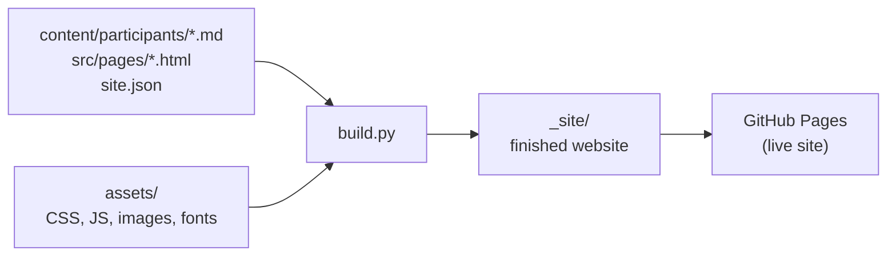

# STEP website

The website for **STEP, the Supporting Transitions to Employment Program**. STEP gives paid, remote work to people experiencing homelessness in Utah County. Participants help BYU's Record Linking Lab link historical census records to the FamilySearch Family Tree while they get ready for long-term jobs.

**Live site:** https://theian-studios.github.io/step/

The site has 6 pages, plus one story page per participant:

| Page | Who it's for |
| --- | --- |
| Home | Everyone. A short summary with links deeper in. |
| About | Donors and partners. Why STEP exists and how it started. |
| How it works | Anyone wanting detail: the three stages, the lab's work, and FAQ. |
| Stories | Participant interviews, one page each. |
| For employers | Hiring managers. |
| Contact | Questions, referrals, donations, hiring. |

## How it's built, in one paragraph

This is a **static site**: plain HTML, one CSS file, one small JavaScript file, and no framework or database. A short Python script, [build.py](build.py), reads the page files and participant stories, fills in the shared header and footer, resizes photos, and writes the finished site into a `_site/` folder. Every time a change is pushed to the `main` branch, GitHub runs that script and publishes `_site/` with GitHub Pages. There is nothing else to host or maintain.



## Quick start

You need Python 3.10 or newer.

```bash
python3 -m venv .venv && .venv/bin/pip install -r requirements.txt
```

```bash
.venv/bin/python build.py --base / && python3 -m http.server 8080 -d _site
```

Then open http://localhost:8080. Re-run the build after each change.

`--base /` builds the site to run from your own computer. Without it, links are set up for the live address under `/step/`.

## Where things live

```text
├── build.py                    Turns everything below into the finished site
├── site.json                   Email, donate link, address, live URL, participant count
├── requirements.txt            Python packages for the build (just Pillow, for photos)
├── content/
│   └── participants/*.md       One file per participant story
├── src/
│   ├── layout.html             Header, footer and <head> shared by every page
│   ├── pages/                  One file per page (Home, About, How it works, ...)
│   ├── partials/               Snippets reused on several pages ("Support the program" band)
│   └── templates/story.html    Layout for every participant story page
├── assets/
│   ├── css/styles.css          All styles
│   ├── js/main.js              Mobile menu, carousel, contact form
│   ├── img/                    Photos, logos, icons
│   └── fonts/                  Newsreader and Public Sans (open-source fonts, self-hosted)
├── docs/
│   └── DEVELOPER-GUIDE.md      How the build and templates work, conventions, troubleshooting
├── tools/trim_fonts.py         Trims the fonts to the weights the site uses (only needed if fonts change)
└── .github/workflows/deploy.yml   Builds and publishes the site on every push to main
```

`_site/` and `.venv/` are created on your computer and are not saved in the repository.

## Common edits

| To change… | Edit |
| --- | --- |
| Words on a page | `src/pages/<page>.html` |
| Menu links (header and footer together) | `site.json` → `menu` |
| The blue "support" band's wording | `site.json` → `support`, or a page's own settings |
| The rest of the footer | `src/layout.html` |
| Email, Facebook link, address | `site.json` |
| "17 people have worked in STEP so far" | `site.json` → `participants_so_far` |
| Colors, text sizes, fonts | the variables at the top of `assets/css/styles.css` |
| A participant's story, or a quote of theirs on any page | `content/participants/<name>.md` |

You can make any of these edits directly on GitHub in the browser: open the file, click the pencil icon, and commit. The live site updates within a couple of minutes. Check progress under the repository's **Actions** tab.

## Adding or editing a participant

1. Upload their photo to `assets/img/`, for example `maria.jpg`. A portrait about 900×1200 px works best.
2. Create `content/participants/maria.md`. The file name becomes the page address (`stories/maria.html`).

```markdown
---
name: Maria
order: 6
photo: maria.jpg
photo_position: 50% 30%
quote: A quote in Maria’s own words, shown at the top of her story.
card_quote: A short version for her card (under 8 words).
---

First paragraph of the story.

Second paragraph. Use *asterisks* for italics.

> “A line starting with > becomes a large pull quote.”
```

The lines between the two `---` marks are settings. Everything after them is the story.

| Setting | What it does | If left out |
| --- | --- | --- |
| `name` | First name shown everywhere. | The file name, capitalized. |
| `order` | Position in lists. Lower numbers come first. | Listed last. |
| `quote` | Large quote at the top of their story page. | No quote. |
| `photo` | File name in `assets/img/`. | Their card shows their initial, and they stay out of the home page carousel. |
| `photo_position` | Which part of the photo stays visible when it's cropped. The second number moves the crop up (smaller) or down (larger). | `50% 30%` |
| `card_quote` | Short quote for their card. | Uses `quote`. |
| `hero_quote` | Quote for the home page carousel. | Uses `card_quote`. |
| `summary` | An opening paragraph placed before the story. Also used as the description in search results and link previews. | The story's first paragraph is used for search results. |
| `status` | A small label on their card and story, for example `Now working full-time`. | No label. |

To post an update on someone's progress, add a heading and a paragraph at the end of their story:

```markdown
## Update: March 2027

Alison finished the program and started a full-time job.
```

## Donate link and contact form

Both are set in `site.json`:

- **`donate_url`**: where every Donate button goes. Right now it opens the contact form with "Donations" selected. Replace it with a real giving page link when there is one.
- **`form_endpoint`**: blank means the contact form opens the visitor's own email app with their message filled in. To have messages sent straight from the site, create a free form at [Formspree](https://formspree.io) or [Web3Forms](https://web3forms.com) and paste its URL here.
- **`url`**: the site's public address. Change it if you set up a custom domain.

## What the build produces

- A complete HTML page for every page and every participant. Nothing depends on JavaScript to show up.
- Link previews for Facebook, iMessage and other apps, with a cropped photo for each story page.
- Resized WebP photos, so phones download small images.
- Search-engine data: `sitemap.xml`, `robots.txt`, and structured data for the organization, stories, breadcrumbs and FAQs.
- A 404 page, and redirects from old addresses (`story.html?p=jan` and `stories.html`).

## Open items

These need decisions or material from the STEP team, not code:

- A real online giving page for `donate_url`.
- A form service for `form_endpoint`, so messages don't depend on the visitor's email app.
- A photo for Candace.
- A custom domain and a program email address in place of the current Gmail one.
- Real photos of the lab and program to replace the illustrative ones on About, Employers and How it works.
- Outcome numbers (hours worked, people who moved on to other jobs) and the names of the people who run STEP.

## More detail

[docs/DEVELOPER-GUIDE.md](docs/DEVELOPER-GUIDE.md) explains how the build and templates work, every placeholder a page can use, the CSS and JavaScript conventions, the design rules the site follows, and how to fix common problems.
